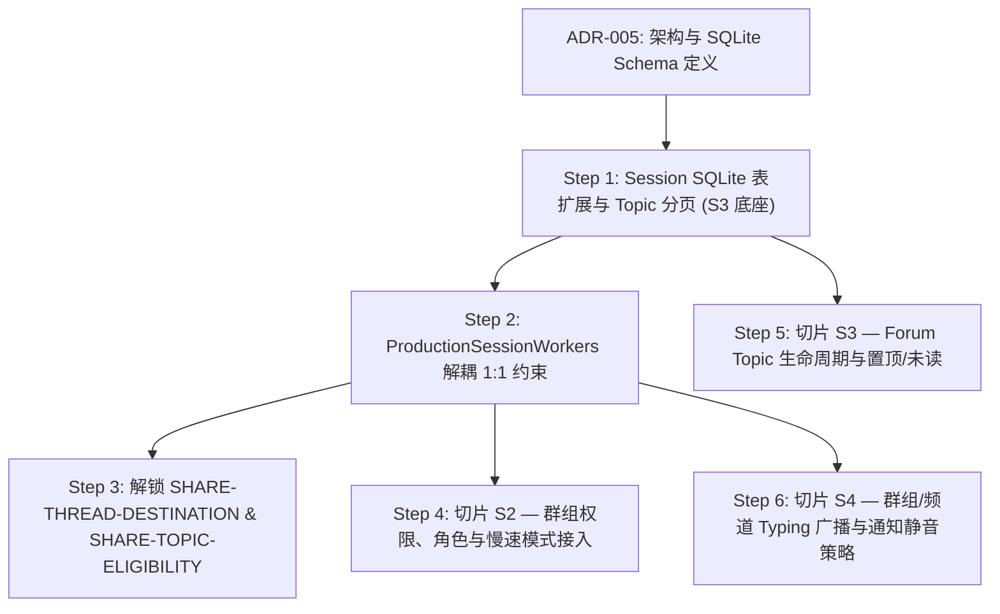

# FBCP-ADR-005: 桌面 Session 承载 Group / Channel / Forum Topic 子会话

- **Status**: accepted (决策架构提案，指导切片 S1b/S2/S3/S4 实施)
- **Date**: 2026-11-04
- **Supersedes**: 无。细化并在 Session SQLite 落地 [FBCP-ADR-004](FBCP-ADR-004-single-message-owner.md)。
- **Applies to**: FBCP-001 / TDRP-001 / FMEP-001 §14、§15 (S1~S4)。

---

## 1. 现状与问题分析

依据 [FBCP-ADR-004](FBCP-ADR-004-single-message-owner.md)，`ProductionSessionWorkers`（桌面 Session）是唯一消息状态 owner，`fabushi_messaging_core` 为共享无状态纯策略库。但审计当前代码，桌面 Session 仅支持 1:1 Human 私聊，所有路径均硬编码了参与者为恰好两人的假设：

1. **会话标识与元数据强绑定双人**：
   - `source/host/src/extensions/session/production.rs:3032-3041`：`human_direct_conversation_id` 仅接收 `first` 和 `second` 并对排序后二元组做 SHA-256，固定格式 `human-direct-{hex}`；
   - `production.rs:3083-3086`：创建会话校验 `local_human_id == peer_human_id`，只能生成 1:1 对话；
   - `production.rs:3193-3196` 及 `3246-3253`：`human_creation_summary` 与 `read_human_conversation_metadata` 强制 `participantIds.len() == 2` 且两 ID 互异；
   - `production.rs:3046-3048`：`validate_human_retry_conversation` 校验重试会话参与者必须严格等于原两人。
2. **消息收发与转发排他性校验**：
   - `production.rs:3823-3830`：`authorize_forward_source` 要求来源会话 `participantIds.len() == 2` 且哈希等于 `source_id`；
   - `production.rs:3941-3945`：`deliver_forward_batch` 目标校验 `if participants.len() != 2 || !self.metadata_has_local_human(&metadata)?`，直接阻断了向群组或频道转发；
   - `production.rs:2147-2152`：`validate_remote_human_reactions` 限制表情反应总数与本地状态为 `(0, false) | (1, false) | (1, true) | (2, true)`，硬编码总参与人上限为 2；
   - `production.rs:422-431`：`local_call_peer` 强校验 `participants.len() != 2`。
3. **分页游标作用域强约束**：
   - `source/host/src/extensions/session/agent_db_transcript_pages.rs:362-370`：`human_snapshot_scope` 要求 `participantIds.len() == 2` 且 `conversationKind == "human"`，序列化 `(conversation_id, local, peer)` 作为游标快照唯一作用域。
4. **现有 `group_chat_glue` 的真实含义**：
   - `source/host/src/extensions/transcript/group_chat_glue.rs:41-208` 属于 **Sand Agent 多智能体协同转接胶水**。其成员限定为本地 `AgentId`（`is_group == true`，配置存在各 agent 目录下的 `group.json` / `SandGroupConfig`），调度走 `send_group_fanout.rs`。它完全不包含 Human 多人通信、网络同步、成员角色、慢速模式或 Forum Topic，不可直接用于 Human 社交群聊。

---

## 2. 决策：会话种类与子会话在 Session SQLite 中的架构表示

### 2.1 会话种类与子会话身份领域模型映射
完全复用 `native/mahayana-messaging/src/conversation.rs` 已有权威枚举：
1. **会话种类**（`ConversationKind`，L19-27）：
   - `Direct`：1:1 私聊（兼容现有 `"human"` 字符串）；
   - `Group`：多人普通群组 / Supergroup；
   - `Channel`：广播频道（仅管理员/频道身份发言）；
   - `SavedMessages`：收藏夹。
2. **子会话身份**（`ConversationChildIdentity`，L214-220）：
   - `Topic { root_message_id: String }`：Forum Topic（以根消息 ID 为全局唯一标识）；
   - `SavedSublist { participant_id: ActorId }`：收藏夹按发起人/对话分类的子列表；
   - `Conversation { conversation_id: ConversationId }`：嵌套关联讨论组。

### 2.2 存储架构：单会话 SQLite（`store.db`）表结构演进
每个会话独立保留 `<agents_root>/<conversation_id>/store.db`。ID 生成规则：
- Direct：保持 `human-direct-{sha256(sort(u1, u2))}`（完全兼容）；
- Group：`group-{server_group_id}`；
- Channel：`channel-{server_channel_id}`；
- SavedMessages：`saved-{local_user_id}`。

在 `store.db` 保持原有 `kv`、`blobs`、`transcript_entries` 表不变的基础上，新增版本化扩展：
```sql
-- 1. Forum Topic 子话题元数据表（对应 ForumTopicState, community.rs:91-105）
CREATE TABLE IF NOT EXISTS conversation_topics (
  topic_id TEXT PRIMARY KEY,               -- 即 root_message_id
  title TEXT NOT NULL,
  icon TEXT,
  creator_id TEXT NOT NULL,
  created_at_ms INTEGER NOT NULL,
  pinned INTEGER NOT NULL DEFAULT 0,
  closed INTEGER NOT NULL DEFAULT 0,
  hidden INTEGER NOT NULL DEFAULT 0,
  last_message_id TEXT,
  unread_count INTEGER NOT NULL DEFAULT 0
) STRICT;

-- 2. 成员与角色权限本地快照表（服务端权威缓存，对应 CommunityMember, community.rs:53-63）
CREATE TABLE IF NOT EXISTS conversation_members (
  actor_id TEXT PRIMARY KEY,
  status TEXT NOT NULL,                    -- owner | administrator | member | restricted | left | banned
  admin_title TEXT,
  admin_rights TEXT,                       -- JSON string: AdminRights
  restrictions TEXT,                       -- JSON string: MemberRestrictions
  joined_at_ms INTEGER NOT NULL,
  invited_by TEXT,
  updated_at_ms INTEGER NOT NULL
) STRICT;

-- 3. 子会话置顶消息索引表
CREATE TABLE IF NOT EXISTS conversation_pins (
  child_scope TEXT NOT NULL,               -- '' 表示会话主页，'topic:<root_id>' 表示子话题
  message_id TEXT NOT NULL,
  pinned_at_ms INTEGER NOT NULL,
  pinned_by TEXT NOT NULL,
  PRIMARY KEY (child_scope, message_id)
) STRICT;

-- 4. transcript_entries 子话题加速索引（不改动原有数据与列定义）
CREATE INDEX IF NOT EXISTS idx_transcript_topic
  ON transcript_entries(json_extract(entry, '$.topicId'), seq)
  WHERE json_extract(entry, '$.topicId') IS NOT NULL;
```

### 2.3 分页与游标升级（`agent_db_transcript_pages.rs`）
- `human_snapshot_scope` 泛化为 `conversation_snapshot_scope(metadata, child_identity)`：
  - Direct：`("direct", cid, local, peer, child)`；
  - Group：`("group", cid, local, child)`；
  - Channel：`("channel", cid, child)`。
- `HUMAN_TRANSCRIPT_ORDER_CTE` 增加子话题过滤：
  `WHERE (?child_scope IS NULL AND json_extract(entry, '$.topicId') IS NULL) OR (json_extract(entry, '$.topicId') = ?child_scope)`。

### 2.4 版本与同步规则
- **会话版本号**：`kv` 表 `"metadata"` 中维护 `canonicalRevision: u64`。由服务端在每次元数据变更（如重命名、权限、Topic 变动）时自增，客户端拉取时如发现版本号不连续则触发增量差分对齐（Delta Sync）。
- **消息版本号**：复用 PR137 规范，每条消息携带 `revision: u64`、`edited_at`、`deleted_at`（tombstone）。

---

## 3. 信任边界矩阵

| 输入要素 | 来源 | 可信度 | 校验与权威归属 |
|---|---|---|---|
| 发送文本、附件、目标会话及 Topic | Renderer (UI) | 不可信 | Host 参数校验，检查格式与大小 |
| 成员身份、管理员角色、禁言限制 | Renderer (UI) | **绝对禁止** | **严禁从 RPC 参数接收**；仅能由 Host 从 `conversation_members`（服务端下发快照）读取 |
| 慢速模式冷却时间（`slowModeSeconds`） | Server / Host Cache | 服务端权威 | Host 发送前对比本地 `last_send_timestamp`，若超频直接在 Host 拦截，不打服务端 |
| 成员变更、封禁、解禁、踢人 | Server | 唯一权威 | 经由 Host 网关向服务端发起请求，获得 HTTP 200 后才原子更新本地 `conversation_members` |
| 转发资格与 Topic 状态 | Host / Core 函数 | 本地权威决策 | Host 调用 `fabushi_messaging_core` 纯函数判定，依据本地最新快照决策 |

---

## 4. 后端依赖与现状逐项对照（基于 `/fabushi-backend` 审查事实）

> 审计基线：本地仓库位于 `/Users/bhrum/Documents/ChatGPT/fabushi-backend`，当前读取 commit 为 `d292250d`（分支 `codex/idempotent-global-dandelion-approval`），`origin/main` 为 `687718ce`（#136）；桌面待集成的后端 PR137 在 backend main 上对应 commit `@4e0878d1`。

| 业务能力 | 所需接口与字段 | 后端现状（commit `4e0878d1` / `d292250`） | 缺口性质与处理方案 |
|---|---|---|---|
| 1:1 单聊消息收发与反应 | `/api/social/messages` (GET/POST), `/api/social/messages/:id/reactions` | **已有** (`community-routes.js:70-76`) | 正常使用 |
| 1:1 变更分页与墓碑 | PR137: `afterId=0` 分页，`revision`, `edited_at`, `deleted_at`, `direct_message_mutations` | **已有代码，尚未部署** (`20261031_human_message_mutations.sql`) | **P0 阻塞**（属于切片 S6，需用户批准生产执行） |
| 群组与频道基础资源 | `POST/GET /api/social/groups`, `POST/GET /api/social/channels`（元数据、标题、设置） | **完全缺失**（后端仅有旧 `co_practice_groups` 表，无 IM 群组表） | **P0 阻塞**（服务端需新增表与路由） |
| 群组/频道消息发收与分页 | `POST /api/social/messages` 增加 `conversationId`/`topicId`；`GET` 支持 `conversationId` | **缺失**（当前代码硬编码 `targetUserId` / `contactId`） | **P0 阻塞**（线协议不支持多人群消息） |
| 成员列表与权限管理 | `GET/POST /api/social/groups/:id/members`，支持 `adminRights`、`restrictions` | **完全缺失** | **P0 阻塞**（服务端权限模型未建立） |
| Forum Topic 生命周期 | `POST/GET/PATCH /api/social/groups/:id/topics`（root_message_id, 标题, 置顶, 关闭） | **完全缺失** | **P0 阻塞**（服务端 Topic 模型未建立） |
| 慢速模式防刷冷却 | 服务端消息写入频率限制，超频返回 HTTP 429 + `retryAfter` | **完全缺失** | **P0 阻塞**（服务端未仲裁发言间隔） |

> **关键架构策略**：服务端缺失项写为 **P0 阻塞**。但在桌面端，Session SQLite Schema 扩展、本地离线消息读写、纯策略库校验（M5/M6）以及本地测试完全解耦，可先行独立落地并以 local-feedback 验证。

---

## 5. 迁移、兼容性与恢复方案

1. **版本化 schema 迁移**：
   - `kv` 表记录 `schemaVersion`（缺省为 `"1"`，新版本写入 `"2"`）；
   - 在 `SandAgentDb::open_configured_db` 中执行增量幂等迁移；所有新增表使用 `CREATE TABLE IF NOT EXISTS`，索引使用 `CREATE INDEX IF NOT EXISTS`。
2. **对存量 1:1 数据零改动**：
   - 现有 1:1 会话的 `metadata`、`kv` 与 `transcript_entries` 内容完全不改动；
   - 兼容层将 `"conversationKind": "human"` 自动映射并等价于 `ConversationKind::Direct`，历史消息物理序号与 SHA-256 ID 保持不变。
3. **回滚方案（两个稳定版本兼容）**：
   - 旧版本（v1）运行时，SQLite 会自动忽略未引用的新表与索引；
   - 旧版只读取 `kv` 和 `transcript_entries`，新增加的 `conversation_topics` 等表不会影响旧版本的打开、读取和写入，支持跨两个发布版本安全回退。
4. **崩溃与重启恢复**：
   - 保持 SQLite WAL 模式不变；在 `agent_db_recovery.rs:salvage_store_db` 的损坏抢救白名单中加入 `conversation_topics`、`conversation_members` 与 `conversation_pins`，保证在文件损坏重构时完整挽救群组与子会话元数据。

---

## 6. 对 S2/S3/S4 与 SHARE 职责的解锁关系与分步实施计划



### 分步实施计划（每步独立合入、具备完整测试）：
- **Step 1（Schema 与分页底座）**：修改 `agent_db_schema.rs` 与 `agent_db_transcript_pages.rs`，增加新表 DDL 与包含 `topicId` 的分页支持。
  - 用例：`source/host/tests/session_topic_pagination_contract.rs`（验证 Topic 分页隔离、游标向前向后遍历、1:1 零退化）。
- **Step 2（Session 多会话种类支持）**：在 `production.rs` 增加 `create_group_conversation` / `create_channel_conversation`，解除 `participants.len() == 2` 在群会话路径上的限制。
  - 用例：`source/host/tests/session_group_creation_contract.rs`。
- **Step 3（Share 职责完全闭环）**：将 `ConversationDestination::topic` 接入 `deliver_forward_batch`；调用 `fabushi_messaging_core` 判定 Topic 是否关闭或受限。
  - 交付：`TDRP-R9-SHARE-THREAD-DESTINATION-001` 与 `TDRP-R9-SHARE-TOPIC-ELIGIBILITY-001` 推进至 `implemented`。
- **Step 4（切片 S2）**：将 `CommunityMember` 权限矩阵与慢速模式冷却接入 `append_human_message` 前置检查。
  - 用例：群禁言发送失败负例、慢速模式冷却中发送失败负例。
- **Step 5（切片 S3）**：实现 Topic 创建/置顶/关闭/未读数聚合 RPC 与前端列表对接。
- **Step 6（切片 S4）**：群级别 Typing 状态管理与通知静音设置落地。

---

## 7. 被否决的方案及理由

1. **否决方案 1：复用 `MessagingEngine` 的 `_messaging/snapshot.json` 全量文件**
   - *理由*：已被 [FBCP-ADR-004](FBCP-ADR-004-single-message-owner.md) 彻底否决。全量 JSON 文件锁导致桌面多窗口并发卡顿，无增量事务与 WAL，无法承受海量消息和大群规模。
2. **否决方案 2：复用现有的 `group_chat_glue.rs` 与 `group.json`**
   - *理由*：`group_chat_glue` 专用于 Agent 智能体协同转接，成员受限于本地 Agent ID，无用户权限、无服务端同步协议、无 Topic 分区。改造它会导致 Agent 系统与人类即时通讯系统概念混淆。
3. **否决方案 3：为每一个 Forum Topic 单独建一个 SQLite `store.db`**
   - *理由*：若单个 Forum 群包含数千个子话题，将产生数千个 SQLite 数据库文件，导致文件描述符耗尽；跨 Topic 消息全文搜索与全群未读数聚合需要并发打开数千个连接，性能极度低下。保持“一会话一库、库内按 Topic 索引分区”为最优解。
