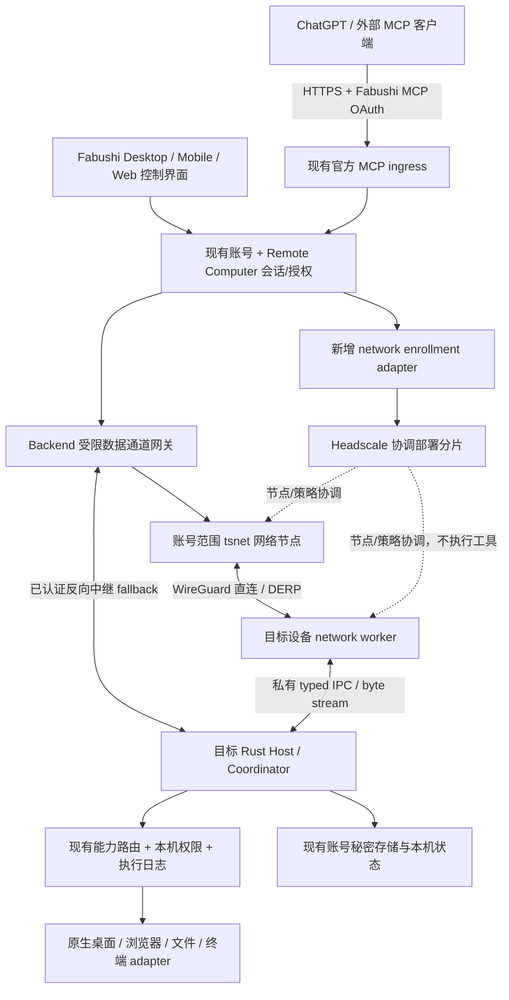

# Fabushi 同账号设备网络与官方 MCP 控制规格

Spec ID: FDN-001  
Status: draft — architecture proposal ready for implementation review; runtime not implemented by this document  
Owner: Fabushi Desktop Host/Coordinator + Platform Core Remote Computer + Backend gateway maintainers  
Created / last reviewed: 2026-10-14  
Delivery scope: 本次只提交规格，不修改生产代码、账号、网络配置或设备授权。  
Related specifications: `fabushi-plugins-marketplace-owner-inventory.md`; `remote-computer-mobile-session-reconciliation.md`; `spec-first-ai-development.md`.

> 产品目标：用户安装 Fabushi，登录同一个 Fabushi 账号，并完成必要的一次性远程控制授权和操作系统权限后，就能通过 Fabushi 官方 MCP 发现并操作该账号下允许被控制的设备。用户不需要另装 Tailscale、不需要再注册网络账号、不需要复制设备令牌、填写 IP、配置路由器或逐台部署 MCP。
>
> 技术决策：保留现有账号、Computer/Remote Computer、Host/Coordinator、权限和官方 MCP；用独立 Go network worker 嵌入 Tailscale `tsnet`，把它作为私有连接能力，而不是第二套产品。Headscale 是建议采用的自托管协调适配器，不能被当作现成的 SaaS 多租户账号系统。`chatgpt-vps-control` 提供执行器和协议行为参考，不整体复制其独立认证、设备数据库与安装系统。

文中 MUST / MUST NOT 是实现要求，SHOULD 是有记录的例外才可偏离的默认设计。带“新增/拟议”的路径、字段和接口尚不存在或本次没有证明存在。所有时延、资源数字是验收目标或初始配置，不是已经测得的结果。

## 1. Context / problem

当前问题不是缺少一个 VPN 安装说明，而是缺少一条完整的产品链路：安装 → Fabushi 登录 → 设备登记 → 授权 → 连通 → 能力发现 → 官方 MCP 调用 → 本机执行 → 审计与撤销。

三个系统解决的问题不同：Fabushi 决定“谁能控制谁、能做什么”；Tailscale 的网络实现负责“如何安全送达”；平台原生执行器负责“如何读取屏幕、操作应用、访问允许的文件”。将三者混在一个新服务里，会重复账号、设备、会话和权限所有权，破坏现有架构。

现有 Remote Computer 已有设备、配对客户端、会话、信令、路由和审计数据结构。[S3][S4] 现有 AuthService 已有 userId、deviceId、sessionId 和私有凭据交付。[S2] 因此本项目必须扩展这些 owner，而不是再引入一个权威 Device Registry。

外部 MCP 的公网调用者不是私有设备网络中的节点。仅让两台安装了 Fabushi 的电脑互通，不能证明 ChatGPT → 官方 MCP → 指定设备已经打通。本规格同时定义这两条路径。

## 2. Goal

### 2.1 必须交付的用户体验

用户在电脑 A、电脑 B 安装签名 Fabushi 安装包，分别登录账号 U。在愿意被控制的设备上开启“允许本账号已授权客户端控制此设备”，选择能力范围并完成系统权限；在外部客户端连接 Fabushi 官方 MCP 时使用同一 Fabushi 账号授权一次。随后：

1. `list_devices` 返回 U 的可见设备及真实状态，离线设备也能被识别为离线。
2. `describe_device_tool` 返回指定设备当前可用能力的精确参数和限制。
3. `device_call` 在许可范围内控制选中的设备，返回实际结果、操作标识及可解释失败原因。
4. 网络更换、短时断线、设备重启后自动恢复连接；不能因重连重复点击、重复执行命令或重复写文件。
5. 暂停远程控制、撤销 MCP 授权、退出账号或切换账号后，旧调用立即停止被本机接受，并有有界的远端撤销保证。

“同账号”以 Fabushi 服务端认证的不可变主体为准，不以邮箱、显示名、机器名、IP 或 Tailscale 用户名相等为准。正常流程不要求手动配对码；现有配对关系仍以相同 owner 和安全边界持久化，只是由经过认证的同账号流程自动建立。

### 2.2 可验收结果

桌面端最低交付 macOS、Windows、Linux X11/显式管理的无头 Linux；移动端和 Web 使用相同账号设备目录作为控制端。平台不能支持的被控能力必须显式标记 `unsupported`，不得展示假按钮或用在线状态替代能力可用性。iOS 不承诺对其他 App 的任意后台控制；Android 屏幕共享与系统级输入分别处理授权和平台限制。[W7][W8]

## 3. Non-goals / out of scope

本项目不创建通用 VPN 产品、第二套身份提供商、第二套 MCP Marketplace、第二套 Agent/Computer 执行引擎，不接管 Fabushi 消息、通话或通知的网络协议。默认不启用出口节点、子网路由、Tailscale SSH、Funnel、全系统代理或全系统 DNS 修改。

不承诺绕过锁屏、UAC、安全桌面、macOS TCC、浏览器扩展授权、移动系统沙箱、休眠或断电限制。不因为登录同账号自动授予 shell、管理员权限或全部文件访问。不将公共 Tailscale 免费服务或公共 DERP 当作未核实的产品生产依赖。

不整仓搬入 Tailscale，不为保持语言统一重写 WireGuard/NAT 穿透。第三方源码许可证、商标、分发义务和托管服务条款分别审查，不能用“开源”替代该审查。

## 4. Requirements

| ID | 要求 |
| --- | --- |
| FDN-R01 | 一个 Fabushi 主体与设备身份；跨 issuer 的标识必须通过受验证的主体映射，禁止邮箱合并。 |
| FDN-R02 | 登录后自动登记/恢复本账号设备；幂等，不重复生成设备；不要求单独的 Tailscale 登录。 |
| FDN-R03 | 登记、网络在线、授权、系统权限、可执行能力分别表示；同账号不等于拥有全部权限。 |
| FDN-R04 | 公网官方 MCP 保持四个现有入口和动态描述模式；内部统一落到既有 Host/Coordinator。 |
| FDN-R05 | 应用范围网络 worker 使用固定版本的上游实现；其故障不得拖垮聊天、账号或整个 Host。 |
| FDN-R06 | 直连、DERP、反向中继使用同一身份与执行授权；不可用时不降级到裸 HTTP 或通用 shell。 |
| FDN-R07 | 网络规则、目录、信令、能力、调用、结果、审计与缓存均有跨账号负向测试。 |
| FDN-R08 | 登记票据一次性、短时有效；网络节点只能绑定已认证设备；节点身份不能自报取得其他账号权限。 |
| FDN-R09 | 账号令牌、设备凭据、节点密钥、MCP grant、会话票据相互隔离，renderer 和日志不得取得秘密。 |
| FDN-R10 | 每次执行在云端和目标 Host 验权；撤销/退出/切号/权限代际变更后旧请求失败关闭。 |
| FDN-R11 | 创建会话和有副作用操作具有持久 requestId、结果查询与 outcome_unknown 语义；不承诺通用 exactly-once。 |
| FDN-R12 | 桌面和浏览器操作保留目标身份、快照代际、坐标空间、并发仲裁及执行后观察语义。 |
| FDN-R13 | 文件、终端、上传下载、剪贴板和敏感输入分别授权，具有路径、资源与审计边界。 |
| FDN-R14 | UI 展示控制来源、授权范围、连接状态、权限修复入口和本机停止开关。 |
| FDN-R15 | 原生控制、现有 Remote Computer/WebRTC、Authorized Remote Runner、App Agent Surface 不能互相挪用凭据。 |
| FDN-R16 | 安装、后台运行、升级、回滚和卸载闭环；不要求在用户设备安装编译工具或执行构建。 |
| FDN-R17 | 新旧协议协商，旧客户端不因未知字段崩溃；不能静默把旧账号或旧共享 token 升级成新授权。 |
| FDN-R18 | 上游版本、来源、许可、SBOM、签名和精确提交可追溯；生产部署与源码对应关系可查。 |
| FDN-R19 | 构建、lint、schema check、测试、基准和验收仅在 GitHub Actions；无环境即未验证。 |
| FDN-R20 | 分阶段实现但按端到端要求验收；不能以 ping 成功、mock 通过、MCP tools/list 或旧 SHA 绿灯宣称完成。 |

## 5. Current state — verified and not yet verified

### 5.1 2026-10-14 源码基线

| 仓库 | 本次读取的 main exact SHA | 用途 |
| --- | --- | --- |
| `bhrumom/fabushi-desktop` | `371b72f1cd20de03dc4dff9a15ed761054968093` | 目标客户端架构、账号、规格、MCP owner 与 App Agent Surface adapter |
| `bhrumom/fabushi-platform-core` | `e23abe4e7a616b3f7184cb14d9e7c7904888e0ba` | 当前账号/Remote Computer Worker、共享契约及持久状态 |
| `bhrumom/fabushi-backend` | `f02f86176f88a2d5e9cb985c4299dfb76cc8ed13` | 当前 Backend 分支基线；具体公网 MCP 部署 owner 尚须进一步建立源码证明 |
| `bhrum/chatgpt-vps-control` | `7530305173ecaea816f14d0aa44b9d7ccf3433a9` | 用户指定的跨平台执行器、动态设备发现、反向连接、敏感输入参考 |
| `bhrumom/fabushi` | `7f2935500cec3a199caf7823557ce5d106e051f4` | 仅对照旧集成残留，不成为新的并行实现 owner |

这些 SHA 是规格研究基线，不是本功能已经通过测试的证明。实施前必须重新读取相关 HEAD，记录差异；禁止把旧证据转贴成新 HEAD 验收。

### 5.2 已核实的集成点

- Desktop `FabushiAuthService` 提供登录状态订阅、operation epoch、秘密存储和 Host 凭据文件；已有 userId/deviceId/sessionId。[S2]
- Platform Core 的 `remote_computers`、`remote_computer_clients`、`remote_computer_sessions`、`remote_computer_signals` 是既有数据结构；已有 provider、capabilities、路由和审计迁移。[S3][S4]
- `deploy/platform-worker/Cargo.toml` 的 lib 实际指向 `third_party/mahayana/mahayana-rs/mahayana-platform-worker/src/lib.rs`，不能在错误的 `deploy/platform-worker/src` 再建同名 owner。[S3]
- 现有 Marketplace owner inventory 明确 Host/Coordinator 是 MCP 执行和权限边界；Backend MiniApp Marketplace 是扩展目录 owner。目录可见性不等于设备执行许可。[S5]
- Desktop 的 `chatgpt-vps-control/` 本次查到的是 `lib/app-agent-surface-client.js` 及声明文件，不是完整的 standalone server。该 client 使用私有 discovery 文件、loopback HTTP、有限操作集合和本地 token。[S6]
- 指定参考项目有原生桌面、浏览器、文件、终端执行行为，以及 Cloudflare Worker + 出站 WebSocket 的动态设备调用模式。[S7][S8]

### 5.3 必须明确的差距

**会话契约漂移**：Desktop 的 RCS 规格要求 stable requestId 和 reconcile；本次读取 Core 的 `RemoteComputerSessionCreateRequest` 只有 clientId/clientToken，且使用 deny_unknown_fields。[S4][S9] 必须先证明目标部署已支持新契约，或在 Core 修复并协商版本；不能直接从客户端多发字段并声称兼容。

**生产 MCP 源码归属未闭合**：本会话只读调用官方 MCP，得到测试账号标签 `fabushi_mcp_ci_test` 和空设备列表。这里只证明四工具入口可调用；不证明真实账号没有设备，不证明授权错误，更不证明生产设备控制完成。实际 MCP URL、部署版本、主体映射、registry 后端须由 P0 获取可审计证据。本次不改绑连接器或登记真实设备。

**参考项目不是目标认证方案**：参考 Worker 的独立控制密码、共享 gateway token 迁移兼容，不进入本产品的新授权路径。旧 monolith README 的 noauth 状态/审计、URL token、十年访问令牌也不得继承。[S8][S10]

**开源范围**：Tailscale 核心客户端和 DERP 可研究复用，但官方协调服务不是该开源仓库提供的可自部署产品；Headscale 是独立实现，公开目标是单 tailnet/小规模使用。[W1][W3] 不能假设它已经提供 Fabushi 所需的多租户治理或高可用。

## 6. Target state

### 6.1 首次使用与常态使用

安装包同时交付经过签名的 Host、network worker 和该平台必要的执行 helper。用户登录后，Host 以现有账号/设备身份登记目录；未开启被控权限时也能显示 `remoteControlDisabled`，不得后台捕获屏幕。

开启远程控制时，一次展示“本账号已授权客户端”范围，以及屏幕读取、输入控制、指定目录文件和终端的独立开关。屏幕/输入默认按用户选择启用；文件需要选目录；终端默认关闭；管理员执行不包含在普通终端权限内。允许保存明确的设备级授权，不在每个低风险动作上反复询问。外部 MCP 初次授权、新增高权限和系统权限仍须真实用户批准。

以后只要用户保持登录、设备在线且权限有效，设备自动恢复；用户只选择设备与能力，不接触 IP、WireGuard key、Headscale、DERP 或内部证书。无头 Linux 使用同一账号的短时浏览器登录/device-code 流程，不把账号密码塞入安装脚本。

### 6.2 逻辑架构



这是逻辑关系，不允许据此增加第二个账号库、独立 MCP 产品或无边界的代理。Native-to-native 可直接经过两端 worker，使用相同会话和授权；Web/移动首版可通过受限网关，不要求手机运行桌面式守护进程。

### 6.3 数据保密边界

WireGuard/DERP 保护网络节点之间的流量，DERP 不承担工具语义授权。普通 MCP 请求和工具结果会被 MCP ingress / 应用网关处理；不能宣传为“ChatGPT 或 Fabushi 服务端都看不到普通工具内容”。需要私密输入时另走用户卡片到目标设备的专用加密路径。端到端能力、TLS 终点和日志边界必须在部署文档逐跳标明。

## 7. Architecture / ownership

### 7.1 现有 owner 与新增最小适配器

| 责任 | 现有 owner / 已验证路径 | 本规格允许的增量 |
| --- | --- | --- |
| 登录/登出/切号 | Desktop `source/product/fabushi/fabushi-account-service.ts` | 订阅既有生命周期，交付账号 epoch；不另建登录页和 refresh store |
| 设备、客户端、会话 | Core `.../mahayana-platform-worker/src/worker_api/remote_computer.rs` | 同账号自动配对、网络 binding、requestId/reconcile、会话授权扩展 |
| 共享规则与协议 | Core `third_party/mahayana/mahayana-rs/mahayana-platform-core/` 与 `contracts/` | versioned network/control 契约、授权判定与错误码；客户端消费固定版本 |
| 产品执行/并发/本机许可 | Desktop `source/host/` 的现有 Host/Coordinator/Computer/权限体系 | network supervisor、受认证的 remote-call adapter、执行幂等日志；先定位具体生产 caller，再在其 owner 增量接线 |
| UI、OS 包装 | `frontend/`、`source/electron-main/`、`source/packaging/` | 设备状态和权限设置、原生 helper 生命周期、签名资源；renderer 只看脱敏投影 |
| App 内语义自动化 | `chatgpt-vps-control/lib/app-agent-surface-client.js` | 仍只由本机受信 adapter 调用；不得把 discovery token 暴露给远端 |
| 扩展目录 | Backend 既有 MiniApp Marketplace | 官方设备能力可有目录入口，但安装目录项不能授予控制权限 |
| 公网 MCP ingress/路由/部署 | 现有官方 MCP endpoint；Backend 部署边界 | 延用公网入口与四工具契约；P0 闭合实际生产源码；新增受限网络 gateway deployment，不重建 registry |
| 网络实现 | **新增** Desktop `source/network-worker/`（拟议） | Go `tsnet` 薄封装，私有 IPC、状态存储适配与连接观测，不含 shell 或产品权限策略 |
| 协调设施 | **新增** Backend `deploy/device-network/`（拟议） | Headscale、DERP、账号范围 gateway、声明式配置、部署/回滚证明 |

表中新增路径是本规格的落点建议，不是对现有文件的事实声明。发现相同责任已有合适模块时，复用该模块并在实施 PR 更新映射，不另建更大的 owner。

### 7.2 ADR-01：Go worker，而非把 Go runtime 嵌入 Rust Host

选择上游 `tsnet` 的高层 `Start/Up/Listen/Dial/Close` 能力，优先不依赖未稳定的内部包。它是 Go 嵌入库并使用 userspace 网络栈。[W2] 保留 Rust Host 的产品所有权，通过进程边界隔离 Go runtime、内存峰值、崩溃和上游升级。

不选择整仓复制：带入无关 CLI、GUI、服务策略和长期合并负担。不选择本阶段全 Rust 重写：改变范围、增加协议和安全验证成本。不选择要求用户自行安装系统 tailscaled：不满足安装 Fabushi 即可准备的体验，而且会与用户既有 VPN 的状态和权限混淆。

worker 必须显式设置可信 ControlURL、每账号独立 Dir/Store，清理继承环境中的 `TS_*` /认证覆盖项；不能缺配置时悄悄加入 Tailscale 默认服务或复用旧账号 state。上游 StateStore 的默认文件持久化、日志上传行为须在固定版本审查；出站 allowlist 必须验证不会泄漏到未批准的遥测/控制域名。[W4]

### 7.3 ADR-02：自托管协调适配器，不重写协调协议

建议采用 Headscale adapter；Fabushi 的认证 broker 只在验证现有用户、设备和授权后，为网络节点申请短时一次性登记材料。Headscale user/node/tag 是网络投影，不是业务账号事实来源；后台管理 API 和凭据只对内部服务开放。

不需要先把 Fabushi 变成完整 OIDC provider 才能登记设备。未来若选择 OIDC，只以受验证的 issuer+subject 映射主体，不能用邮箱作为绑定键。使用托管 Tailscale 作为可替换 provider 必须另行验证账号自动接入能力、产品条款和成本，不能作为当前已获批准的依赖。

### 7.4 ADR-03：账号网络域与部署分片

每个账号拥有一个逻辑 network domain。物理层采用容量有界的 Headscale cell；是否容纳多个账号不是 Headscale 自带保证，而是 Fabushi 的安全责任。最初可使用单账号隔离 cell；**未通过完整隔离验收，禁止在一个 cell 打开第二个生产账号**。

多账号 cell 必须由服务端编译显式 default-deny 策略，只允许已经绑定的账号内节点与该账号的 gateway 节点访问 Fabushi 专用端口。不得使用全局 `*:*`，不得以一个通用 gateway tag 获得全部用户网络权限。不能只按同名 Headscale user 推断隔离；policy、peer map、节点名称/DNS、审计和 DERP 接入都要验证。

Headscale 未配置 policy 时允许节点互通，空对象也不是 deny-all；初始化时就必须提供经过固定版本校验的 deny-all policy，并以成功加载的 revision 作为 readiness 条件。[W5] 编译失败、新节点未绑定或策略回滚不得回到 allow-all。

跨账号隔离不成立时，回退到独立账号 cell，而不是减弱应用鉴权；容量成本不满足时保持灰度并另写容量 ADR。不能把单进程存储复制成“多副本共享 SQLite”后宣称 HA。gateway 按账号隔离运行上下文和网络身份，有界缓存/按需启动；不同账号不得共享一个 tsnet state 目录。

### 7.5 ADR-04：公网入口保留，网关补足私网接入

继续使用已部署的 HTTPS MCP ingress。网络 gateway 是其内部受限数据路径，不是第二套公开工具服务器。普通 Edge Worker 不承载 tsnet/Headscale/DERP 守护进程；这些部署在允许 Go 进程、UDP 和长连接的 Linux 服务环境，由 Actions 部署。

gateway 只接受经过现有服务身份认证、指向特定账号/设备/会话的请求，不能接收任意 URL、任意端口或任意 SOCKS 目标。账号范围 gateway node 到设备可走直连或 DERP；UDP 不通可走 DERP；overlay 整体不可用时使用已认证反向 WSS 通道。fallback 必须携带同一个执行 envelope，不能以共享 `DEVICE_GATEWAY_TOKEN` 替代授权。

### 7.6 与现有其他通道的关系

Remote Computer WebRTC 视频和交互会话保持自己的 transport contract；DERP 不等于 TURN。不得为了引入 overlay 把所有视频再塞进一层不必要的 TCP 隧道。默认保持既有视频路径，仅在协商允许时增加 overlay 控制/文件路径。

若现有会话路由锁定，新的 carrier 切换必须在兼容的 versioned contract 中定义：允许的底层 path 改变记录 routeEpoch，但不改变会话授权；不兼容的 provider 切换关闭旧会话、按显式恢复创建新会话，绝不重放未知结果动作。

Authorized Remote Runner 的 bearer、Remote Computer 的 mobileToken/deviceSecret、App Agent Surface 的 loopback token 各自只在原本边界使用。[S6][S9] 新链路必须进入统一能力路由，不能把其中一个凭据当作另一个的通行证。

## 8. Interfaces / contracts / schemas / flows

### 8.1 主体、设备和密钥

| 项目 | 权威及存储 | 不允许的用法 |
| --- | --- | --- |
| account principal | 既有 Fabushi auth/账号映射；服务端从已验证身份获得 | 从调用参数、邮箱、网络昵称决定账号 |
| deviceId | 既有账号设备身份，关联既有 Remote Computer registration | 以网卡/IP为永久身份；每次重启新增设备 |
| device authentication key | Host 在系统秘密存储生成/持有；服务端存公钥及代际；可迁移现有设备凭据 | 发给 renderer、MCP 或其他设备 |
| network machine/node keys | worker 的账号隔离加密 StateStore | 跨账号复用；云端保存私钥；克隆安装后共用同一身份 |
| MCP grant | 既有账号授权服务，绑定外部 client/connection、资源 audience 与 scope | 用登录 access token 直接透传给设备 |
| execution ticket / lease | Core 以现有会话与授权生成，目标 Host 校验；签名密钥在服务端安全存储 | 只有“网络可达”就执行；长期万能设备 bearer |

新的 device authentication key 用来加强已有登记关系，不创建第二种产品设备。遇到 auth deviceId 与 legacy remote deviceId 不一致时，需通过当前有效设备凭据和本机确认建立受审计 alias；不得根据机器标签自动合并。安装克隆、备份恢复导致并发身份冲突时暂停控制并重新证明绑定。

### 8.2 登记与恢复流程

1. AuthService 完成正常登录，Host 获取当前 accountEpoch 及设备身份；UI 只拿脱敏状态。
2. Host 幂等创建/恢复既有 Remote Computer registration。未允许被控时不启动 capture/input helper，也不接收远程动作。
3. 获得设备级许可后，Host 持久化 enrollment requestId，以当前账号认证、设备证明和预期 epoch 请求网络登记。
4. Core 在持久记录后调用协调 adapter；网络预授权只能使用一次，建议最长 120 秒，且初始节点必须在无业务访问权限的 quarantine 范围。
5. worker 通过私有 IPC 接收一次性材料，连接到可信 ControlURL。Host 取得实际注册的网络公钥/节点标识，使用设备认证私钥证明绑定；Core 对照协调服务记录完成绑定，才生成允许规则。
6. **预授权 key 是 bearer，不假设 Headscale 原生把它绑定到了应用设备公钥**。窃取/抢注不得获取业务权限；非预期节点必须留在 quarantine 并删除。绑定确认需要实际节点身份及设备 proof，不能仅信任 hostname 或客户端自报 nodeId。
7. 绑定/策略完成后，Host 完成应用层相互认证，公布可用 capabilities；没有收到响应时用原 requestId reconcile，不生成另一台设备。
8. 日常重启使用账号范围 state 恢复；凭据过期时仅进行网络重认证，不能重新授予用户已经关闭的权限。

协调服务与 D1 不是一个数据库事务。必须采用持久 outbox/saga：本地保存 desired binding/revision → 外部幂等创建/撤销 → 记录 observed state。发生不确定结果先查询/对账；不得为“继续执行”重复签发仍有效的登记票据。

### 8.3 拟议控制平面接口

以下在既有 `/v1/computers` 资源下扩展；最终路由名、schema 文件和数据库迁移编号由 Core 实施 PR 以最新源码确定。旧路由不得被悄悄改成不兼容含义。

| 接口 | 请求要点 | 结果/边界 |
| --- | --- | --- |
| `POST /v1/computers/:deviceId/network/enroll` | requestId、protocolVersion、deviceProof、expectedCredentialEpoch；account 来自认证 | enrollmentId、可信控制服务配置、短时私有登记材料；仅该设备 Host可收取 |
| `POST .../network/enroll/reconcile` | 同一 enrollment/requestId 与设备证明 | 同一 enrollment 状态；不能无限再次返回已消耗 key |
| `POST .../network/bind` | enrollmentId、实际 network node identity、公钥证明 | bindingRevision、policyRevision、scope；未通过不开放权限 |
| `GET .../network/status` | 本账号权限 | 脱敏状态，不返回网络私钥/设备密钥/管理 API key |
| `POST .../clients/authorize-self` | 原生 controller identity 或 MCP connection、requestedScopes、target consent revision、stable requestId | 在现有 remote_computer_clients 下建立客户端授权；无手动配对码，不跳过授权 |
| `POST .../sessions` / `.../sessions/reconcile` | 版本协商后的 clientId、clientToken、requestId | 遵循现有 RCS 规格，复用同一 session；不暴露 deviceSecret |
| `POST .../sessions/:sessionId/operations` | requestId、toolName、schemaRevision、参数摘要及内容 | operationId、accepted/running/terminal/outcome_unknown；持久接受后才返回 accepted |
| `GET .../sessions/:sessionId/operations/:operationId` | 相同主体/客户端授权 | 可恢复的结果状态，不因 GET 再执行 |
| `POST .../revoke` | expectedRevision、范围 device/client/grant、requestId | 权限 epoch 先失效，再异步撤销网络；返回 pending 清理而不是伪装全部完成 |

网络 enrollment 只给目标本机使用，不能作为外部 MCP 工具让模型代收 node key。恢复材料仅在仍满足 account/device/client/epoch fence 时交付。

### 8.4 官方 MCP 外部兼容契约

保留本次实际可见的接口：

```text
fabushi_account()
list_devices()
describe_device_tool(deviceId, toolName)
device_call(deviceId, toolName, argumentsJson, timeoutSeconds?)
```

`argumentsJson` 保持 JSON 字符串兼容，不擅自改成 object。入口有已公布的载荷和 timeout 上限；这些上限不是对所有工具的授权，实际仍取 gateway、设备 schema、授权策略中的最小限制。不得因为通用 tool 名叫 device_call 就把所有子调用标注为只读或可自动重试。

拟议 v2 可增加可选 `requestId`、`expectedSchemaRevision`，必须通过 tools/list 和版本协商公布，旧客户端省略也可正常首发调用。网关为首次请求持久生成 operationId；跨传输重试保留同一内部 requestId。旧客户端在“响应丢失且不知道 operationId”时不能保证任意重复调用只执行一次，应返回/保留不确定状态，先在受权审计/操作查询中恢复。不能用 JSON-RPC id 或相同参数摘要代替跨会话幂等键，也不能合并用户两次有意相同的点击。

`list_devices` 返回脱敏投影，至少包含 deviceId、label、platform、lastSeenAt、presence、remoteControlEnabled、capabilityRevision 和可解释的 unavailableReason。离线、锁屏、权限缺失、网络不通是不同原因。

`describe_device_tool` 必须基于可信 adapter 支持范围与当前许可的交集，而非原样信任设备任意上报的 tool descriptor。返回 input/output schema、副作用类别、requiredScopes、平台限制、schemaRevision、重试/幂等分类；验证 schema 大小、引用、正则及描述文本边界。工具描述不是可以改写授权规则的指令。

### 8.5 授权与执行 envelope

外部 MCP 使用 Fabushi 账号授权服务发放的专用资源令牌；验证 issuer、audience/resource、有效期、授权连接与 scope。OAuth 采用 PKCE、严格 redirect、state/issuer 防混淆、受保护资源发现；不用 URL query/path 放访问令牌，不接受任意其他服务 token 透传。[W6] 现有 outbound MCP OAuth broker 与此 inbound MCP 授权方向不同，不能只改一下路由名当作同一个流程。

内部签名 envelope 至少包含以下语义；使用成熟签名/证书库，禁止自行设计密码算法：

```json
{
  "version": 1,
  "issuer": "fabushi-control-plane",
  "audience": "fabushi-device-runtime",
  "accountId": "server-resolved-principal",
  "deviceId": "existing-device-id",
  "clientId": "existing-authorized-client",
  "connectionId": "native-or-mcp-authorization-connection",
  "sessionId": "existing-remote-computer-session",
  "operationId": "durable-operation-id",
  "requestId": "stable-client-request-id",
  "toolName": "computer_use_bridge",
  "schemaRevision": "negotiated-revision",
  "argumentsDigest": "sha256-of-canonical-arguments",
  "credentialEpoch": 7,
  "grantRevision": 12,
  "routeEpoch": 2,
  "issuedAt": "server-time",
  "expiresAt": "no-more-than-60-seconds-after-issue"
}
```

示例字段是拟议契约，不代表当前已支持。设备必须验证签名、目标、账号、客户端、当前本机授权、epoch、schema、参数摘要、期限和 replay 状态；`accountId` 不是由调用者填写后自动可信。网络 peer identity 和应用层证书/ticket 都要验证。TLS peer 用独立 Fabushi 设备证书/固定信任根，不依赖 Headscale 必然提供公网证书签发能力。

同一操作在 routeEpoch 变化后仍使用同一个 requestId/operationId。若 grant 被撤销、lease 过期或本机拒绝，任何网络 fallback 都不能绕过它。

### 8.6 本机 IPC 与状态机

worker 的最低私有 IPC 语义为 `hello(protocolRange)`、`start(accountEpoch,binding,credentialHandle)`、`openAuthorizedPeer(bindingId,service)`、`acceptStream`、`status`、`closeStream`、`stop`。字段名可在实现时规范化，但不能出现通用 shell、任意文件读取或“替调用者批准权限”。

命令通道有有界帧、关联 ID、超时、取消、版本协商；字节流单独复用或通过私有 socket/pipe 传递，有 backpressure，不把大文件 base64 挤进控制 IPC。Unix socket 验证本机用户及权限，Windows named pipe 有限定 SID 的 ACL；只用继承句柄/短时 handshake secret，不监听 `0.0.0.0`。loopback HTTP 不能单凭 loopback 就免认证。

```text
signedOut
  -> registered(remoteControlDisabled)
  -> consented
  -> enrolling
  -> quarantined
  -> bound
  -> connecting
  -> ready | degraded | offline
any active state -> paused | revoked | signedOut
```

网络状态和能力状态是正交维度，例如 `ready + screenPermissionMissing`。账号 epoch 改变时，取消旧任务、停止 worker/输入流、关闭旧 stream 和 snapshot，清除旧账号活动凭据后才启动新账号；异步旧回复不得写入新账号 store。

worker 崩溃采用有界指数退避与熔断，初始可为 1/2/4/8/16/30 秒加抖动；不能用无限快速重启刷日志和占盘。Host 本身存活，UI 显示降级，不把 network worker 状态当作整个产品 ready 状态。

### 8.7 持久化模型

扩展既有 Remote Computer 记录，新增的仅是从属网络投影与操作记录，建议逻辑实体如下；不得未经源码确认直接照抄为迁移 SQL：

| 从属实体 | 核心字段与不变量 |
| --- | --- |
| device network binding | accountId + existing deviceId + provider；cellId、node public identity、state、credentialEpoch、bindingRevision、policyRevision；复合授权键唯一 |
| enrollment attempt | account/device/requestId 唯一；requestDigest、expiry、state、externalCorrelation、quarantine identity；只保存必要 hash/加密恢复材料 |
| client grant extension | 既有 clientId 关联 native device 或 MCP authorization connection；范围、target consent revision、撤销代际 |
| operation journal | account/device/client/requestId 唯一；argumentsDigest、tool/schema、accepted/started/terminal/outcome_unknown、bounded result reference |
| control-plane outbox | desired revision、外部幂等键、retry deadline、observed state；不存长期明文 secret |

Host 也持久化 accepted/started/terminal 记录，先记 durable acceptance 再做副作用。同 requestId + 不同参数摘要必须 conflict。会话过期、日志清理后旧请求仍不能再次执行：保留有界 replay tombstone，且验证原请求期限；不能仅因为 cache miss 就当新命令。保留期依据最长重试窗口、会话有效期和隐私政策配置。

## 9. Constraints / non-functional requirements

### 9.1 安全、可用性与撤销目标

拟议 execution lease 最长 60 秒，每次操作和持续流都检查租期。在线且撤销消息可达时目标 5 秒内停止接受新动作；控制平面分区时最迟租期失效后停止。2 小时的现有控制会话有效期不等于允许离线继续执行 2 小时。

撤销先失效业务权限，再撤销网络节点/ACL。缓存的 WireGuard peer 即便仍能建连，也不能取得新的应用执行权。长操作在 lease 失效时停止新输入并尝试取消受控进程组；已发生的副作用无法回滚，无法确认终止时保留 `cancellation_pending` / `outcome_unknown`，不得虚报已取消。

服务端、Host 与 gateway 都执行账号隔离、限速和参数约束；目录/操作查询的跨账号请求不泄漏目标是否存在。失去可信时间或过大 clock skew 时禁止建立新执行授权，不能延长 ticket 宽限期解决。

### 9.2 资源、性能与存储

初始产品目标：健康网络和已完成权限条件下，登录后 30 秒内目录可见；对在线设备的状态发现 p95 小于 2 秒，控制 transport 额外往返 p95 小于 300ms（测试环境 RTT 不超过 100ms，不包含 App 自身动作时间）。直连、DERP、WSS 分开计量，不能拿本地 loopback 冒充互联网结果。

暂定空闲 network worker 稳态 RSS 预算 150 MiB、5 分钟均值 CPU 小于单核 1%；以 Actions 对照基线验证，达不到就先优化/修订明确预算，不伪造数据。Screenshots 默认有界缩放与质量，UI/semantic state 不无限积累；日志轮转建议每组件 20 MiB 上限。

凡下载资源、导出、上传暂存和升级都做 peak-space preflight。初始安全底线是峰值分配后仍保留 `max(1 GiB, volumeCapacity * 5%)`，不能计算则拒绝大写入并给可修复原因。此为本规格的强制产品预算，不声称本次已审计所有现有 disk guard。

只清理 Fabushi 自有、可证明无活动引用的缓存、临时导出与旧版本；不清理用户文件来“腾空间”。普通控制会话不下载源码、不创建依赖目录、不触发本机编译。

### 9.3 密钥、隐私与供应链

必须审查固定上游版本的全部网络外发，包括日志、DNS、DERP map、更新检查和认证 fallback。默认只允许批准的 Fabushi/自托管网络依赖；确需第三方诊断时另行知情授权并脱敏。

worker state 使用账号独立的私有目录和加密存储，封装密钥存入系统秘密存储。没有可用的秘密存储时 fail closed 或提供经过明确设计的受限模式，不静默写明文。崩溃报告、命令行参数、环境 dump、CI artifacts 不能含账号 token、AuthKey、node private key、屏幕明文或文件内容。

Tailscale 根 LICENSE 为 BSD-3-Clause 类型条款，仍须保留版权/许可声明、检查传递依赖、输出第三方 notices/SBOM。[W9] 参考项目的源码复用授权逐文件确认；本次根目录观察不是对其整体再分发许可的认定。网络/原生 helper 由受保护 Actions 构建、签名、发布，验证 manifest digest 和最低安全版本；不远程执行未签名脚本作为更新。

## 10. Failure modes / edge cases

| 场景 | 必须行为 |
| --- | --- |
| 登录成功但本机未同意被控 | 目录可见、明确 remoteControlDisabled；不截屏、不执行 |
| OS 权限缺失/被收回 | 能力立即降级；返回具体权限与修复入口，不循环重试点击 |
| 锁屏/UAC/非活动桌面 | 停止输入；只返回不泄漏受保护画面的有限状态；不尝试解锁绕过 |
| UDP 被禁/复杂 NAT | 切 DERP；不因直连失败更改账号/权限 |
| overlay 故障 | 可用时进入同授权的 reverse WSS；没有安全通道则 unavailable |
| Headscale 未加载策略/错误 revision | 新网络登记暂停；不得默认 allow-all；健康原有连接也需有效应用 lease |
| enroll/create 响应丢失 | 同 requestId reconcile；不创建第二个节点或会话 |
| 操作已发送但回应丢失 | 查询 durable operation；不自动执行第二次 |
| 动作完成但截图失败 | action=executed，observation=unavailable；禁止重试动作来获取截图 |
| 操作执行中进程死亡 | 不确定边界记 outcome_unknown；用户/调用者先观察确认，不能保证恰好一次 |
| 同 requestId 不同参数 | conflict，零副作用 |
| 两个客户端争抢鼠标/键盘 | 同一交互桌面单写 lease/队列；拒绝过期 owner，不能交错输入 |
| 浏览器标签页导航/关闭后 ID 被复用 | generation/claim 失效，重新 list+claim；不控制新页面 |
| 同名机器/IPv4变更/重新安装 | 用身份及 proof，不用 label/IP 匹配；重装默认新实例并处理旧设备撤销 |
| A 切到 B 时旧请求完成 | accountEpoch 不匹配丢弃旧结果、关闭旧流，不污染 B |
| revoke 期间网络仍可达 | Host 业务 fence 拒绝；未确认外部清理保留 pending |
| 离线设备/关机/睡眠 | 正确显示；新 UI mutation 不无限排队，唤醒后重新授权/观察 |
| 磁盘不足/额度不足 | 预检拒绝；已有业务不被破坏，按拥有权清理临时数据 |
| 旧协议不支持 reconcile | 明确 capability unavailable；不发送未知必需字段或静默无限重试 |
| 服务配置/签名/runner 缺失 | 标注 blocked/not-configured，推进其他任务，绝不记 pass |

建议统一错误码：`account_mismatch`、`device_not_visible`、`device_offline`、`remote_control_disabled`、`permission_required`、`interactive_session_unavailable`、`unsupported_capability`、`schema_stale`、`snapshot_stale`、`control_busy`、`operation_conflict`、`outcome_unknown`、`lease_expired`、`revoked`、`transport_unavailable`、`disk_budget_exceeded`。错误信息不回显秘密或未授权设备身份。

## 11. Implementation strategy

### 11.1 能力吸收，不复制整套 standalone server

| 能力族 | 参考行为 | Fabushi 落点与限制 |
| --- | --- | --- |
| 设备/环境/应用列表 | environment、applications、state | 现有 Computer 能力 owner；可信平台状态，无伪造在线/使用历史 |
| App 内与桌面语义控制 | app_state、elements、element_action、use_bridge | 优先原生语义 API；App Agent Surface 保持本机边界；用新 snapshot 接力 |
| 坐标与窗口控制 | computer_use、computer_window | 明确 app/desktop 坐标空间、DPI/多显示器、窗口身份/代际；语义不可用才降级 |
| 浏览器 | browser_session、locator、cua、utility | exact tab claim；托管 profile 与已登录浏览器扩展分别显示；不导出 cookies/profile |
| 文件 | file_info、read/write、download | 指定目录、canonical path、symlink/race 防越界、分块与校验、受权临时下载 |
| 终端 | run_shell_command、recent_commands | 现有受权执行/审计 owner；明确 shell.execute 高权限，不默认 sudo |
| 敏感输入 | 私密用户卡片/一次性挑战 | 单独安全输入 adapter，值不经过模型/普通 device_call；能力未接好就不开放 |

现有 Fabushi 对应能力优先扩展；仅在缺口明确且许可确认后吸收 helper/算法。原生 helper 保持平台语言（例如 Swift/Windows 原生接口），不强制转为 Go 或 Rust。不要把 shell 包装成“只读状态工具”；shell 能进行任意程序执行，必须按实际风险授权。

文件写入默认使用 staging + 原子提交，覆盖需显式许可/expectedVersion；检测路径穿越、符号链接、挂载切换和并发更新。下载 URL 必须短时、账号/会话授权、禁止目录枚举；普通公开 URL 不能取代用户授权。剪贴板读写、网页上传和终端输出都是独立的数据外发边界。

浏览器扩展不能静默安装/开启。Fabushi 内置浏览器或受控 profile 与用户现用 Chrome 区别展示；需要原浏览器登录态时才引导用户批准签名扩展/Native Messaging。扩展只暴露被精确选定的目标，不自动扫描并控制全部标签页。

敏感输入挑战必须绑定 account/device/client/session、动作模板摘要、期限和一次性 nonce；用户在私密 UI 输入，目标设备解密和代入受权操作。挑战消费与执行记录持久化；响应丢失不得重放 OTP 或支付确认。参考加密流程不是未经安全评审可直接复制的完整密码协议。[S8]

### 11.2 平台交付矩阵

| 平台 | 控制其他设备 | 被控范围 | 发布门槛 |
| --- | --- | --- | --- |
| macOS Desktop | 是 | 授权后的 AX/屏幕/输入、受限文件与可选终端 | 稳定 bundle identity、签名/公证、TCC 授权/撤回、锁屏和多显示器 |
| Windows Desktop | 是 | 授权后的 UIA/输入/捕获、受限文件与可选终端 | 签名 helper、交互用户 session、UAC/锁屏拒绝、每用户 IPC ACL |
| Linux X11 | 是 | 授权活动会话；文件/终端；可选私有无头桌面 | X11/AT-SPI 可用性、logind/session 边界；无头显示明确标注 |
| Linux Wayland | 是 | 仅经过实际 portal/backend 证明的能力 | 独立 capability gate；未实现则不冒充 X11 可用 |
| Android | 是 | App 沙箱能力；显式授权的屏幕共享/经过合规审核的输入能力 | MediaProjection 每会话同意、前台服务、后台限制、锁屏停止；不默认设备 root |
| iOS/iPadOS | 是 | Fabushi App 公开支持的沙箱内能力；可选用户发起共享 | 不宣称任意其他 App 操作/常驻 shell；后台能力受系统 API 限制 |
| Web/PWA | 是，经 gateway | 不作为通用本机控制 agent | 不声称浏览器能后台常驻 Go worker；账号/会话/授权与原生一致 |

移动/Web 首版用 gateway 控制桌面，不依赖嵌入 Go sidecar。未来手机内嵌网络库或系统 VPN extension 属于独立平台实现和权限审查，不是桌面可执行文件的机械复制。

### 11.3 可执行阶段与并行工作

**P0 — 权威与兼容闭合。** 确认官方 MCP URL→部署→源码 SHA→认证主体→registry 的真实链路；读取最新各仓库 owner；闭合 RCS create/reconcile 差异；锁定 Tailscale/Headscale 兼容版本、license 与目标平台；登记现有权限/执行 caller。输出 source lock、接口差异清单、typed contract 草案。不能以 P0 文档代替实现完成。

**P1 — 账号/授权/持久契约。** Core 扩展现有 Remote Computer 的同账号 client authorization、enrollment、binding、outbox、operation/reconcile；Host 接账号生命周期、key store、revocation 和执行 journal。先完成真实 permission fence，再接网络。

**P2 — 网络 worker 与协调部署。** 独立 Go worker、私有 IPC、加密 StateStore、固定 ControlURL、quarantine binding、deny-all policy、账号范围 gateway、DERP；通过 Actions 的双节点/双账号、UDP 禁止与控制面分区测试。不能只验 ping。

**P3 — 官方 MCP 生产调用接线。** 保留四工具与公网入口，闭合 OAuth 主体、schema projection、scope、执行 envelope、direct/DERP/WSS 的同请求恢复；首条真实能力从 descriptor 到目标 Host 原生 adapter，返回真实结果和审计。

**P4 — 能力与客户端吸收。** 按 11.1/11.2 补齐原生、浏览器、文件、终端与敏感输入；Desktop 设置/状态、Android/iOS/Web 控制页面复用现有 Computer store。功能逐项有真实环境证据，平台不支持项明确处理。

**P5 — 安装发布与独立验收。** 签名安装包、首次登录授权、跨网络、升级/回滚/卸载、账号切换和撤销；受控灰度、成本和性能预算；合并后 main exact-head 再取证。

P0 生产部署凭据或 P4 某平台权限未就绪时，可以继续共享契约、Host 逻辑、worker、模拟故障和其他已配置平台；不能为绕过 blocker 使用假 OAuth/假设备冒充生产。所有可执行验证仍只在 Actions。确有需要用户处理的当前阻塞时，先检查是否已有未解决邮件，再通过 Gmail 告知指定联系人一次；继续推进不受阻的任务，不在规格阶段发送假设性的阻塞邮件。

## 12. Verification strategy — GitHub Actions only

下列 gate 名是拟议测试套件，不声称仓库已有同名 workflow。优先接入现有职责对应 workflow；较重的原生/E2E/签名验收采用显式 dispatch/release 流程，不擅自扩大每次文档提交的构建负担。只在 GitHub Actions 的临时/专用 runner 执行，禁止在个人 bhrum2、Mac、Windows 或助手容器跑构建/测试/lint/schema check。

| Gate | 对应要求 | 必须覆盖的证据 |
| --- | --- | --- |
| G01 account-lifecycle | R01–R03,R09,R10 | 同号登记幂等、不同 issuer 映射、同名设备、切号时并发旧回复、重装/身份克隆 |
| G02 enrollment-state | R02,R07–R09 | 一次性票据抢用、超时、响应丢失、并发绑定、quarantine、外部已创建但本地未记账 |
| G03 tenant-isolation | R07,R10 | A/B 账号的目录、node map/DNS、ACL、信令、schema、结果、审计与下载全面负向测试 |
| G04 worker-contract | R05,R09,R16 | IPC ACL/帧限额、版本不合、进程崩溃/熔断、state 隔离、继承环境污染、未授权外发 |
| G05 real-network | R05,R06,R20 | 两个独立网络命名空间/节点的直连；屏蔽 UDP 强制 DERP；overlay 不可用的 WSS；记录实际 route |
| G06 session-reconcile | R11,R15,R17 | RCS 幂等/唯一约束、旋转 clientToken、lost-response/process-death、旧协议拒绝/协商 |
| G07 mutation-recovery | R10–R12 | accepted/started/terminal 各点故障；截图失败不重做；requestId 冲突；outcome_unknown 不自动重试 |
| G08 revoke-partition | R07,R09,R10 | 网络节点仍在线而业务权限撤销；离线缓存 lease 到期；长操作取消无法确认的真实报告 |
| G09 oauth-mcp | R01,R04,R09,R17 | Fabushi 登录→授权→四工具→真实调用；错误 audience、scope、client、账号和 refresh/revoke；无 token passthrough |
| G10 native-control | R03,R12,R14 | 原生 UI/窗口/DPI/快照、并发控制权、锁屏/UAC、权限授予和撤回 |
| G11 browser-control | R12,R13 | extension/managed profile、tab claim、导航/复用、frame、下载/上传路径、无 cookies 泄漏 |
| G12 files-shell-private | R09,R11,R13 | symlink/遍历/overwrite race、磁盘不足、命令超时/取消、敏感输入无明文/不重放 |
| G13 platform-contract | R04,R14,R15,R17 | Desktop/Android/iOS/Web 设备投影一致；unsupported 不伪装成功；现有视频/Runner 回归 |
| G14 package-lifecycle | R16,R18 | 安装签名、首次使用不编译、重启、升级、回滚、卸载、旧 state/协议兼容 |
| G15 resource-privacy | R05,R09,R13,R18 | RSS/CPU/网络开销/磁盘峰值、日志限额、出站域名、SBOM/许可证、秘密扫描 |
| G16 end-to-end-release | R01–R20 | 两个同账号设备+另一个隔离账号；真实登录、发现、描述、控制、断线恢复与撤销；post-merge exact SHA |

每条证据记录至少含 repo、source SHA、依赖 lock、workflow/run/job、实际命令、环境、退出码、执行/跳过数量、route、artifact 标识及摘要。expected negative tests 需记录拒绝原因和零副作用；无环境的 skip 不是 pass。云端模拟不能代替 macOS TCC、Windows secure desktop 或手机系统权限的真实环境证据。Actions 使用的专用交互 runner/设备缺失时仅相应条目标注未验证，不把个人工作机临时当测试 runner。

## 13. Acceptance / Definition of Done

以下验收针对功能实现，不是本次 docs-only 交付。全部适用项完成后才允许声明“安装并登录同账号即可通过官方 MCP 控制”。

| ID | 验收条件 | 主要 gate |
| --- | --- | --- |
| FDN-A01 | 干净签名安装包无额外源码/Node/Xcode/npm/Go 安装要求，登录后正确登记同一设备 | G01,G14 |
| FDN-A02 | 不登录第二套网络账号、不填写 IP/token、不手动配置路由器，正常用户完成被控设置 | G02,G16 |
| FDN-A03 | 默认未授权能力确实不可执行；启用/撤回系统权限反映到能力与 UI | G01,G10,G13 |
| FDN-A04 | 官方 MCP 授权到同一不可变 Fabushi 主体，列出正确设备，真实 describe→call 成功 | G09,G16 |
| FDN-A05 | 在真实不同网络中分别证明 direct、DERP、WSS 路径及相同授权约束 | G05,G16 |
| FDN-A06 | 另一个账号不能枚举、连接、猜 ID 调用、取结果或读审计；不能用同名/邮箱绕过 | G03,G09 |
| FDN-A07 | 账号切换/退出/权限旋转后旧流、旧 snapshot、旧 ticket 和旧异步结果全部被 fence | G01,G08 |
| FDN-A08 | 丢失响应、断线重连、进程死亡不自动重做副作用，能查询或诚实报告未知结果 | G06,G07 |
| FDN-A09 | 锁屏/UAC/TCC/过期 browser claim 拒绝，坐标/DPI/并发控制有正确结果 | G10,G11 |
| FDN-A10 | 文件、终端、剪贴板、上传下载和敏感输入分别有权限和边界，不泄漏秘密 | G12,G15 |
| FDN-A11 | 网络 worker 崩溃不使账号/聊天失效，重试有界；无全局 VPN/DNS/路由副作用 | G04,G15 |
| FDN-A12 | 现有 Computer/WebRTC/Authorized Runner/App Surface 未被替换或挪用凭据 | G06,G13 |
| FDN-A13 | 声称支持的平台逐一有签名安装和原生证据；不支持平台功能明确不可用 | G10,G13,G14 |
| FDN-A14 | 重启、升级、回滚、卸载和清理符合本机授权及账号隔离，无遗留可执行后台身份 | G08,G14 |
| FDN-A15 | 网络、存储、CPU/RSS、遥测、日志和许可证/供应链预算有精确版本证据 | G15 |
| FDN-A16 | 已记录实际公网 MCP 部署 SHA、各仓库集成 SHA、全部适用 gate 和独立验收结论 | G16 |

参考项目某工具存在、tsnet 启动成功、一个 ping、一个截图、HTTP 200、tools/list、stub/fake 成功、predecessor run 成功，均不能独立满足上述 DoD。

## 14. Release / migration / rollback

采用增量迁移：先上线兼容的 Core schema/服务契约与 deny-all 网络设施，再发布 Host/worker 和受限 gateway，最后对已验证账号/设备打开 feature flag。控制 plane 和客户端至少支持当前及上一个受支持协议；旧 `deny_unknown_fields` 请求必须通过路由版本/协商处理。

旧设备保留既有 deviceId/client/session，先建立 proof-backed binding；绝不因标签相同、共享 token 可用或旧 tunnel 在线而自动继承新账号控制权。旧 standalone agent 的迁移需现有账号认证、逐设备证明与能力复核，成功后撤销其旧凭据；不能一键导入共享万能 token 并永久保留。

Feature flag 分为自动登记、overlay、gateway fallback、各能力族、平台和多账号 cell。关闭网络功能不得影响聊天/账号；关闭某一路径不能触发另一路径以更弱权限执行。回滚保留不可逆的撤销 epoch/安全最低版本和操作 tombstone；不能恢复旧 revoked key 或重放未确认操作。

native service 默认为用户会话范围。需要登录后常驻时在产品设置明确启用；“关闭窗口”与“退出 Fabushi/停用远程控制”行为有清楚区分。无头服务器常驻作为明确安装模式，不默认为 root。卸载时尽可能撤销服务端设备、删除自有服务/扩展 native host/秘密；离线卸载无法确认云端清理时，服务端条目标离线/待撤销，业务 lease 自行到期。

控制设施按 cell 灰度，监测跨账号拒绝、route 比例、DERP 带宽、连接故障、成本/设备数及资源预算；有安全隔离异常立即关闭新授权，不以可用性指标抵消安全失败。生产 secret 与签名材料走已批准的密钥管理/Actions protected environment，不进入 spec 或 PR。

## 15. Observability / evidence

沿用现有 action audit 和 Remote Computer transport audit，新增事件作为同一审计体系的类型：`network.enrollment_started`、`network.binding_confirmed`、`network.route_changed`、`control.accepted`、`control.started`、`control.terminal`、`control.outcome_unknown`、`control.revoked`。记录 actor 类型、account/device/client 的受权关联、operationId、时间、capability/schema、route 和失败码，不记录秘密、完整命令参数、剪贴板、屏幕或文件正文。

用户可查看“哪个已授权客户端在何时使用哪台设备的哪类能力”，可本机暂停/撤销。诊断导出默认脱敏；对请求体、截图和详细命令的额外采集需要明确授权、保留期和访问审计。

Spec compliance 是可追溯账本，不是覆盖率百分比。每项从 `planned` → `implemented` → `verified` 的变更必须附真实代码/生产 caller/Actions artifact；`not-applicable` 需解释平台能力限制和用户可见行为。未核实的生产部署映射不能藏在“已接入”统计中。

## 16. References / provenance

### 16.1 内部源码和规格

所有链接固定到本次研究 SHA；实施时在 source lock 记录更新，不直接覆盖旧证据。

- [S1 — Desktop agent/spec-first policy](https://github.com/bhrumom/fabushi-desktop/blob/371b72f1cd20de03dc4dff9a15ed761054968093/AGENTS.md)
- [S2 — FabushiAuthService](https://github.com/bhrumom/fabushi-desktop/blob/371b72f1cd20de03dc4dff9a15ed761054968093/source/product/fabushi/fabushi-account-service.ts)
- [S3 — Core Worker source and migrations](https://github.com/bhrumom/fabushi-platform-core/blob/e23abe4e7a616b3f7184cb14d9e7c7904888e0ba/third_party/mahayana/mahayana-rs/mahayana-platform-worker/src/lib.rs)
- [S3a — Actual Worker lib path](https://github.com/bhrumom/fabushi-platform-core/blob/e23abe4e7a616b3f7184cb14d9e7c7904888e0ba/deploy/platform-worker/Cargo.toml)
- [S4 — Existing Remote Computer contract](https://github.com/bhrumom/fabushi-platform-core/blob/e23abe4e7a616b3f7184cb14d9e7c7904888e0ba/third_party/mahayana/mahayana-rs/mahayana-platform-worker/src/worker_api/remote_computer.rs)
- [S5 — Marketplace ownership inventory](https://github.com/bhrumom/fabushi-desktop/blob/371b72f1cd20de03dc4dff9a15ed761054968093/docs/specs/fabushi-plugins-marketplace-owner-inventory.md)
- [S6 — Local App Agent Surface client](https://github.com/bhrumom/fabushi-desktop/blob/371b72f1cd20de03dc4dff9a15ed761054968093/chatgpt-vps-control/lib/app-agent-surface-client.js)
- [S7 — Reference native/browser capability behavior](https://github.com/bhrum/chatgpt-vps-control/blob/7530305173ecaea816f14d0aa44b9d7ccf3433a9/README.md)
- [S8 — Reference edge MCP, enrollment and private input](https://github.com/bhrum/chatgpt-vps-control/blob/7530305173ecaea816f14d0aa44b9d7ccf3433a9/cloudflare-worker/README.md)
- [S9 — RCS reconciliation specification](https://github.com/bhrumom/fabushi-desktop/blob/371b72f1cd20de03dc4dff9a15ed761054968093/docs/specs/remote-computer-mobile-session-reconciliation.md)
- [S10 — Legacy monolith documentation, NOT the target auth model](https://github.com/bhrumom/fabushi/blob/7f2935500cec3a199caf7823557ce5d106e051f4/chatgpt-vps-control/README.md)

### 16.2 外部一手资料

访问日期：2026-10-14。它们支持技术选型，不证明 Fabushi 已实现。Tailscale/Headscale 的具体发布版本及完整依赖 SHA 尚未批准，必须在 P0 的兼容验证中锁定；禁止生产依赖 `latest`。

- [W1 — Tailscale open-source boundary](https://tailscale.com/opensource)
- [W2 — tsnet embedding documentation](https://tailscale.com/docs/features/tsnet)
- [W3 — Headscale scope/design goal](https://headscale.net/stable/)
- [W4 — tsnet Server / Store / ControlURL API](https://pkg.go.dev/tailscale.com/tsnet)
- [W5 — Headscale policy defaults and limitations](https://headscale.net/stable/ref/policy/)
- [W6 — MCP authorization specification, researched 2026-07-28 revision](https://modelcontextprotocol.io/specification/2026-07-28/basic/authorization)
- [W7 — Android MediaProjection consent and lifecycle](https://developer.android.com/media/grow/media-projection)
- [W8 — Apple iOS runtime sandbox and background boundary](https://support.apple.com/en-euro/guide/security/sec15bfe098e/web)
- [W9 — Tailscale root LICENSE; release must pin exact version](https://github.com/tailscale/tailscale/blob/main/LICENSE)

## 17. Spec compliance record

本次交付仅完成源码调研与规格编写，不构成实现验收。未运行任何本地构建、lint、测试、schema check、基准或设备控制验收；未安装/改配真实设备；未修改或合并生产代码。

| 范围 | 当前状态 | 说明 |
| --- | --- | --- |
| 规格：目标、owner、接口、风险、分期与验收定义 | authored / review pending | 按仓库 SPEC_TEMPLATE 的职责编写；设计仍需实施 PR 逐项落地 |
| FDN-R01–FDN-R20 | planned / unverified | 未以该规格实现并取得 exact-head 证据 |
| FDN-A01–FDN-A16 | not run | 后续每项最终只能标 passed、blocked 或 not-applicable，并给证据/理由 |
| 当前官方 MCP 部署源码绑定 | evidence gap | 四工具只读观察不能代替生产追溯；P0 关闭该缺口 |
| RCS create/reconcile 跨仓库一致性 | source/spec drift identified | P0/P1 先对齐，禁止按已完成使用 |
| 上游兼容版本、系统权限、平台签名与容量 | release prerequisites | 不影响编写规格；未满足时阻止相应功能发布，继续其他阶段 |

实施接力必须从本规格和最新 exact HEAD 开始，提交代码后继续验证；不得把本节里的 planned 改成 passed，仅因为文档合并、PR 创建或网络节点 online。
